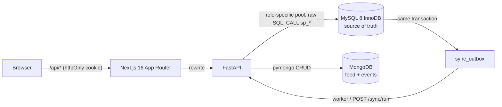
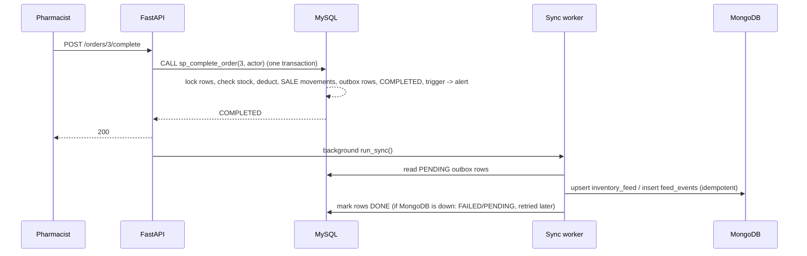
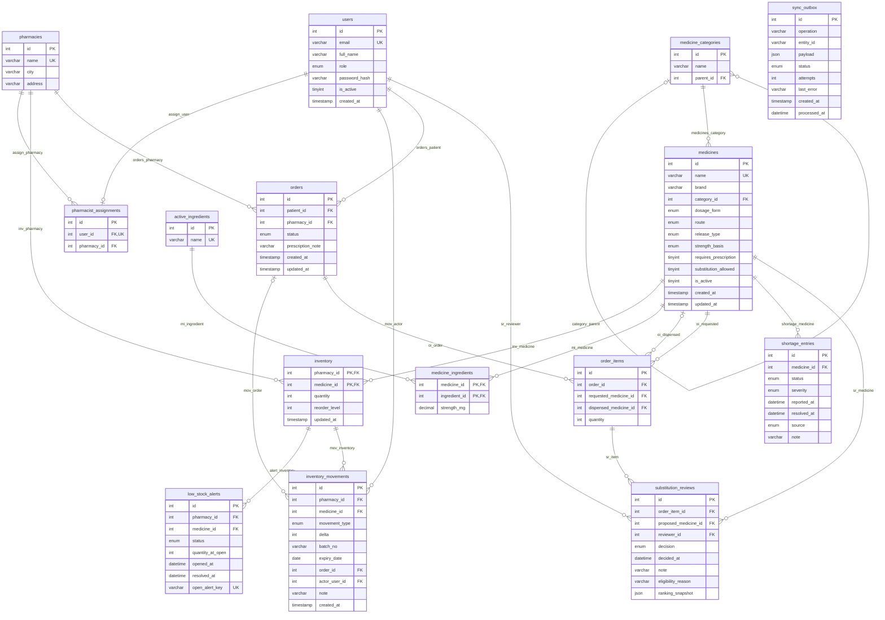

# Design — Medicine Substitution & Shortage Finder

> Educational demonstration. Candidate matches are not medical advice or an authorization to substitute a medicine. A qualified pharmacist must verify the medicine and applicable prescription requirements before any substitution or sale. All data is synthetic.

## 1. Requirements and business rules

| # | Rule | Where it is enforced |
|---|---|---|
| R1 | A patient searches a medicine and sees only an availability band (In stock / Low / Out) per pharmacy, never exact stock. | view `v_availability`, function `fn_availability_band`; search API |
| R2 | A substitution candidate must have the **identical ingredient set and strengths**, same strength basis, dosage form, route and release type, be active, and allow substitution. | view `v_candidate_eligibility` (used by `sp_equivalent_candidates`, `sp_rank_candidates`, `sp_decide_substitution`) |
| R3 | Ranking only orders eligible candidates (stocked at chosen pharmacy, total stock, fewer open alerts, name). It never admits or rejects. | `sp_rank_candidates` |
| R4 | Nothing is substituted or sold without a pharmacist decision. | `sp_decide_substitution` (writes `substitution_reviews`), `sp_approve_order`, `sp_complete_order` |
| R5 | Order lifecycle `REQUESTED → UNDER_REVIEW → APPROVED \| REJECTED → COMPLETED`, `CANCELLED` from any non-terminal state. | trigger `trg_orders_status_transition` + guarded procedures |
| R6 | A sale is atomic: stock deducted, ledger rows, outbox rows and status change commit together or not at all; stock never goes negative; two concurrent sales cannot oversell. | `sp_complete_order`, `CHECK (quantity >= 0)` |
| R7 | Low stock (`quantity <= reorder_level`) opens exactly one alert per pharmacy+medicine; replenishment resolves it. | trigger + `uq_one_open_alert` |
| R8 | A pharmacist works only in the assigned pharmacy; a patient sees only their own orders; only admin edits the catalog, shortages, users. | MySQL roles/grants + guarded procedures (see `SECURITY_RBAC.md`) |
| R9 | MongoDB is a non-authoritative feed/event store. A MongoDB outage never rolls back a sale; a resync repairs it. | transactional outbox (`sync_outbox`) + worker |
| R10 | A prescription-only medicine needs a prescription note before approval. | `sp_approve_order` |

## 2. Architecture and data flow

Request identity: FastAPI validates the signed cookie, re-reads the user (role, active flag, pharmacy) from MySQL, picks the **connection pool of the matching MySQL account/role**, sets `@app_user_id/@app_role/@app_pharmacy_id` and clears them before the connection is reused.

## 3. Technology justification (rubric 5)

| Technology | Distinct role | Why it cannot be swapped for another one here |
|---|---|---|
| **MySQL (InnoDB)** | Authoritative relational store: stock, orders, users, ledger, all eligibility/ranking logic, transactions, roles/grants. | Needs ACID transactions, row locks, FKs/CHECKs, stored routines and per-role privileges. |
| **MongoDB** | Semi-structured inventory feed documents and a heterogeneous event log (`sale`, `receipt`, `adjustment`, `import` events have different payload shapes), with `$jsonSchema` validation and flexible `metadata`. | Variable-shape documents suit a document store; forcing them into MySQL would need an EAV or many nullable columns. It is deliberately **not** a source of truth. |
| **FastAPI** | Thin, typed HTTP layer, auth, identity-to-DB context, outbox worker. | — |
| **Next.js** | Role-aware UI; calls only `/api/*`; no database access. | — |
| **Vector database — deliberately NOT used** | — | Substitution is deterministic: exact ingredient set, strength, form, route and release. A similarity score cannot establish pharmacological equivalence, so embeddings would add a model download, a third sync target and viva risk for no functional gain. The rubric accepts NoSQL **or** vector. |

## 4. ER diagram (rubric 1)

Generated from the live schema by `python scripts/check_schema_docs.py --write`; `python scripts/check_schema_docs.py` fails if the diagram and MySQL ever differ. The same diagram with a per-table column/constraint reference is in [`SCHEMA_REFERENCE.md`](SCHEMA_REFERENCE.md). Cardinality symbols: `||` exactly one, `|o` zero or one, `o{` zero or many.

<!-- ER:START -->

<!-- ER:END -->

(An exported PNG/SVG of the diagram is not committed; GitHub and most Markdown viewers render the Mermaid above. Export with `npx @mermaid-js/mermaid-cli -i docs/SCHEMA_REFERENCE.md` if an image is needed.)

## 5. Relational schema, keys, constraints, normalization (rubric 2)

Table-by-table PK / FK / UNIQUE / NOT NULL / CHECK / DEFAULT detail is generated into [`SCHEMA_REFERENCE.md`](SCHEMA_REFERENCE.md). Summary of the design:

* **Primary keys:** surrogate `AUTO_INCREMENT` ids, except natural composite keys on `inventory (pharmacy_id, medicine_id)` and `medicine_ingredients (medicine_id, ingredient_id)`.
* **M:N:** `medicines` ↔ `active_ingredients` through `medicine_ingredients`, which also carries the attribute that belongs to the pair (`strength_mg`). A combination product is simply several rows. `pharmacies` ↔ `medicines` is `inventory` (carries `quantity`, `reorder_level`).
* **Self-reference:** `medicine_categories.parent_id` (category tree; walked by the recursive CTE).
* **Uniqueness beyond PKs:** `users.email`, `medicines.name`, `pharmacies.name`, `active_ingredients.name`, `pharmacist_assignments.user_id` (one pharmacy per pharmacist), `low_stock_alerts.open_alert_key` (generated column — MySQL has no partial index).
* **CHECKs:** `quantity >= 0`, `reorder_level >= 0`, `order_items.quantity > 0`, `strength_mg > 0`, `delta <> 0`, movement sign by type (added by `ALTER TABLE` in V002), e-mail shape, boolean flags, shortage date order, outbox operation names.
* **ENUMs:** role, dosage form, route, release type, strength basis, order status, movement type, alert/shortage/outbox status, review decision.
* **Normalization (3NF):** every non-key column depends on the key, the whole key and nothing but the key. Composition lives in `medicine_ingredients` (not repeated columns). Category names are stored once. Order header (`orders`) is separate from lines (`order_items`).
* **Stated denormalizations / deliberate choices:**
  1. `substitution_reviews.ranking_snapshot` and `eligibility_reason` copy the decision-time facts (an audit snapshot, intentionally not recomputed).
  2. `low_stock_alerts.quantity_at_open` is a historical value.
  3. `sync_outbox.payload` is a JSON snapshot for MongoDB.
  4. Stock is **one authoritative number** per pharmacy+medicine; batch/expiry live only on `inventory_movements` receipt rows (no FEFO depletion).
* **Strength normalization:** numeric `strength_mg` in the medicine's `strength_basis` (per tablet, per 5 ml, …); compared numerically, never as strings.

## 6. Decisions log

| Decision | Reason | Trade-off |
|---|---|---|
| MySQL **8.0.33** used locally; `docker-compose.yml` pins **8.4 LTS** | Docker is not installed on the dev machine; a local 8.0 server was available. Code uses only features common to both (roles, CHECK, window functions, CTEs, `INSERT … AS alias`). | Local runs were verified on 8.0.33 only; 8.4 via Docker is **not run** (see `TESTING.md`). |
| `SET GLOBAL log_bin_trust_function_creators=1` in `bootstrap_db.py`; compose sets the flag | With binary logging on, non-SUPER accounts cannot create functions/triggers. | Global server setting (resets on restart for a local install; compose keeps it). |
| Dedicated locked `medsub_definer` account owns every `DEFINER`; migrator gets `SET_USER_ID` | Routines run with narrow DML rights, not with the migrator's DDL rights; the definer cannot log in. | Needs bootstrap as root once. |
| Definer also needs `TRIGGER` privilege | MySQL checks it when a trigger fires (found when seeding). | — |
| Fourth role `app_auth_role` (login lookups only) | Login must read the password hash, but no other role may read `users`. | Slightly beyond "3 roles". |
| Request context = session variables read through `fn_ctx_*` functions | MySQL views cannot reference user variables; a function can, so views and procedures share one trusted source. | Trust depends on credentials staying backend-only (stated limitation). |
| Context is set after pool checkout and cleared in `finally`; pool also resets the session | Section 6 warning on pooled connections; verified by `test_context_isolation.py`. | Two extra round trips per request. |
| Low-stock trigger = `AFTER INSERT` + `AFTER UPDATE` triggers calling one procedure `sp_eval_low_stock` | MySQL triggers are per event; one procedure keeps the rule in one place. | Names are `trg_inventory_low_stock_ins/_upd`. |
| `sp_complete_order` stock check uses a **locking read** (`FOR UPDATE`) | The concurrency test showed a plain read used the transaction snapshot from before the lock wait and missed the competing sale (the `CHECK` constraint saved the data, error 3819). | — |
| Deadlock / lock-wait victims (1213/1205) are retried 3× in the API (`db.with_retry`) | InnoDB may abort one of two competing transactions. | — |
| Rows are locked in primary-key order | Deterministic lock order avoids deadlocks between multi-item sales. | — |
| Migration runner implements `DELIMITER` itself; `V###` files once, `R__` files every run | Drivers do not understand `DELIMITER`; routines/views/grants must be re-creatable. | No down-migrations. |
| Workflow procedures named `sp_*` (list in `SQL_REFERENCE.md`) | Section 2 warning 7. | — |
| API creates single-line orders (`sp_create_my_order` takes one medicine) | Keeps the viva-able flow small; tables support several lines. | No multi-line order UI. |
| Outbox worker stops at the first connection failure and uses `last_updated <= occurred_at` guard | Avoid hammering a dead MongoDB; protect against out-of-order retries. | Same-second changes are applied in id order. |
| Outbox `FAILED` rows retry up to `SYNC_MAX_ATTEMPTS` (5); then wait for `POST /sync/retry-failed` | Bounded retries. | Manual step after a long outage. |
| MongoDB tests default to **mongomock**; validator tests need a real MongoDB (`MONGO_TEST_URI`) | Docker was not installed, so a portable MongoDB 7.0.14 zip was run locally for verification. | mongomock hides ordering/validation issues, so run both. |
| `proxy.ts` (not `middleware.ts`) | Next.js 16 renamed it. | — |
| No exported ER image | Mermaid renders on GitHub. | Offline viewers need the export command above. |
| Tokens are stateless JWTs | Simplicity. | Logout only clears the cookie; a stolen token lives until expiry (60 min). Deactivating the user stops it at once because identity is re-read from MySQL on every request. |
