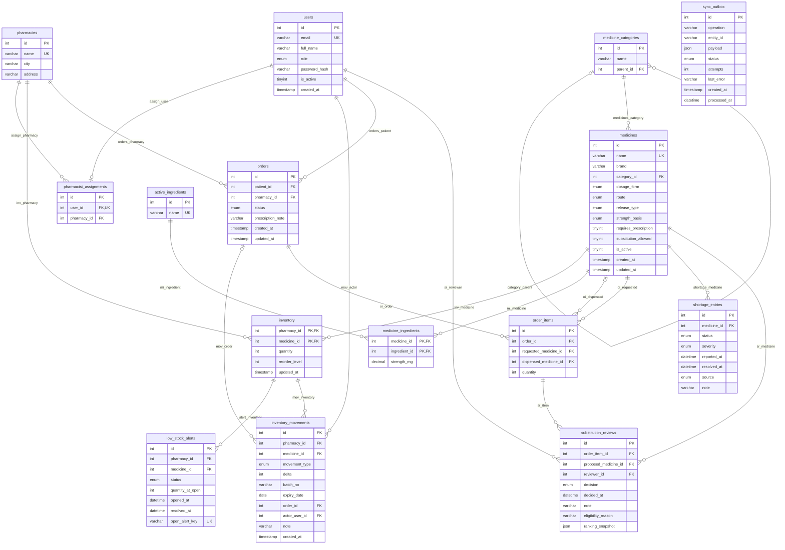

# Schema reference (generated)

Generated from the live MySQL schema by `python scripts/check_schema_docs.py --write`. Do not edit by hand.

## `active_ingredients`

| Column | Type | Null | Key | Default | Notes |
|---|---|---|---|---|---|
| id | `int` | NOT NULL | PRI |  | AUTO_INCREMENT |
| name | `varchar(100)` | NOT NULL | UNI |  |  |

Constraints:
- **PRIMARY KEY** `PRIMARY` (id)
- **UNIQUE** `uq_ingredient_name` (name)

## `inventory`

| Column | Type | Null | Key | Default | Notes |
|---|---|---|---|---|---|
| pharmacy_id | `int` | NOT NULL | PRI |  | FK -> pharmacies.id (ON DELETE NO ACTION) |
| medicine_id | `int` | NOT NULL | PRI |  | FK -> medicines.id (ON DELETE NO ACTION) |
| quantity | `int` | NOT NULL |  | 0 |  |
| reorder_level | `int` | NOT NULL |  | 10 |  |
| updated_at | `timestamp` | NOT NULL |  | CURRENT_TIMESTAMP |  |

Constraints:
- **PRIMARY KEY** `PRIMARY` (pharmacy_id,medicine_id)
- **CHECK** `chk_inv_qty`: `(`quantity` >= 0)`
- **CHECK** `chk_inv_reorder`: `(`reorder_level` >= 0)`

## `inventory_movements`

| Column | Type | Null | Key | Default | Notes |
|---|---|---|---|---|---|
| id | `int` | NOT NULL | PRI |  | AUTO_INCREMENT |
| pharmacy_id | `int` | NOT NULL | MUL |  | FK -> inventory.pharmacy_id (ON DELETE NO ACTION) |
| medicine_id | `int` | NOT NULL |  |  | FK -> inventory.medicine_id (ON DELETE NO ACTION) |
| movement_type | `enum('RECEIPT','SALE','ADJUSTMENT')` | NOT NULL |  |  |  |
| delta | `int` | NOT NULL |  |  |  |
| batch_no | `varchar(40)` | YES |  |  |  |
| expiry_date | `date` | YES |  |  |  |
| order_id | `int` | YES | MUL |  | FK -> orders.id (ON DELETE NO ACTION) |
| actor_user_id | `int` | NOT NULL | MUL |  | FK -> users.id (ON DELETE NO ACTION) |
| note | `varchar(200)` | YES |  |  |  |
| created_at | `timestamp` | NOT NULL |  | CURRENT_TIMESTAMP |  |

Constraints:
- **PRIMARY KEY** `PRIMARY` (id)
- **CHECK** `chk_mov_delta`: `(`delta` <> 0)`
- **CHECK** `chk_mov_sign`: `(((`movement_type` = _utf8mb4\'SALE\') and (`delta` < 0)) or ((`movement_type` = _utf8mb4\'RECEIPT\') and (`delta` > 0)) or (`movement_type` = _utf8mb4\'ADJUSTMENT\'))`

## `low_stock_alerts`

| Column | Type | Null | Key | Default | Notes |
|---|---|---|---|---|---|
| id | `int` | NOT NULL | PRI |  | AUTO_INCREMENT |
| pharmacy_id | `int` | NOT NULL | MUL |  | FK -> inventory.pharmacy_id (ON DELETE NO ACTION) |
| medicine_id | `int` | NOT NULL |  |  | FK -> inventory.medicine_id (ON DELETE NO ACTION) |
| status | `enum('OPEN','RESOLVED')` | NOT NULL | MUL | OPEN |  |
| quantity_at_open | `int` | NOT NULL |  |  |  |
| opened_at | `datetime` | NOT NULL |  | CURRENT_TIMESTAMP |  |
| resolved_at | `datetime` | YES |  |  |  |
| open_alert_key | `varchar(40)` | YES | UNI |  | GENERATED: `if((`status` = _utf8mb4\'OPEN\'),concat(`pharmacy_id`,_utf8mb4\'-\',`medicine_id`),NULL)` |

Constraints:
- **PRIMARY KEY** `PRIMARY` (id)
- **UNIQUE** `uq_one_open_alert` (open_alert_key)

## `medicine_categories`

| Column | Type | Null | Key | Default | Notes |
|---|---|---|---|---|---|
| id | `int` | NOT NULL | PRI |  | AUTO_INCREMENT |
| name | `varchar(100)` | NOT NULL |  |  |  |
| parent_id | `int` | YES | MUL |  | FK -> medicine_categories.id (ON DELETE NO ACTION) |

Constraints:
- **PRIMARY KEY** `PRIMARY` (id)
- **UNIQUE** `uq_category` (parent_id,name)

## `medicine_ingredients`

| Column | Type | Null | Key | Default | Notes |
|---|---|---|---|---|---|
| medicine_id | `int` | NOT NULL | PRI |  | FK -> medicines.id (ON DELETE CASCADE) |
| ingredient_id | `int` | NOT NULL | PRI |  | FK -> active_ingredients.id (ON DELETE NO ACTION) |
| strength_mg | `decimal(10,3)` | NOT NULL |  |  |  |

Constraints:
- **PRIMARY KEY** `PRIMARY` (medicine_id,ingredient_id)
- **CHECK** `chk_mi_strength`: `(`strength_mg` > 0)`

## `medicines`

| Column | Type | Null | Key | Default | Notes |
|---|---|---|---|---|---|
| id | `int` | NOT NULL | PRI |  | AUTO_INCREMENT |
| name | `varchar(150)` | NOT NULL | UNI |  |  |
| brand | `varchar(100)` | NOT NULL |  |  |  |
| category_id | `int` | NOT NULL | MUL |  | FK -> medicine_categories.id (ON DELETE NO ACTION) |
| dosage_form | `enum('tablet','capsule','syrup','injection','ointment')` | NOT NULL |  |  |  |
| route | `enum('oral','topical','injection')` | NOT NULL |  | oral |  |
| release_type | `enum('immediate','extended')` | NOT NULL |  | immediate |  |
| strength_basis | `enum('per tablet','per capsule','per 5 ml','per ml','per gram')` | NOT NULL |  |  |  |
| requires_prescription | `tinyint(1)` | NOT NULL |  | 0 |  |
| substitution_allowed | `tinyint(1)` | NOT NULL |  | 1 |  |
| is_active | `tinyint(1)` | NOT NULL |  | 1 |  |
| created_at | `timestamp` | NOT NULL |  | CURRENT_TIMESTAMP |  |
| updated_at | `timestamp` | NOT NULL |  | CURRENT_TIMESTAMP |  |

Constraints:
- **PRIMARY KEY** `PRIMARY` (id)
- **UNIQUE** `uq_medicines_name` (name)
- **CHECK** `chk_med_flags`: `((`requires_prescription` in (0,1)) and (`substitution_allowed` in (0,1)) and (`is_active` in (0,1)))`
- **CHECK** `chk_med_name_nonblank`: `(char_length(trim(`name`)) > 0)`

## `order_items`

| Column | Type | Null | Key | Default | Notes |
|---|---|---|---|---|---|
| id | `int` | NOT NULL | PRI |  | AUTO_INCREMENT |
| order_id | `int` | NOT NULL | MUL |  | FK -> orders.id (ON DELETE CASCADE) |
| requested_medicine_id | `int` | NOT NULL | MUL |  | FK -> medicines.id (ON DELETE NO ACTION) |
| dispensed_medicine_id | `int` | YES | MUL |  | FK -> medicines.id (ON DELETE NO ACTION) |
| quantity | `int` | NOT NULL |  |  |  |

Constraints:
- **PRIMARY KEY** `PRIMARY` (id)
- **CHECK** `chk_oi_qty`: `(`quantity` > 0)`

## `orders`

| Column | Type | Null | Key | Default | Notes |
|---|---|---|---|---|---|
| id | `int` | NOT NULL | PRI |  | AUTO_INCREMENT |
| patient_id | `int` | NOT NULL | MUL |  | FK -> users.id (ON DELETE NO ACTION) |
| pharmacy_id | `int` | NOT NULL | MUL |  | FK -> pharmacies.id (ON DELETE NO ACTION) |
| status | `enum('REQUESTED','UNDER_REVIEW','APPROVED','REJECTED','COMPLETED','CANCELLED')` | NOT NULL |  | REQUESTED |  |
| prescription_note | `varchar(500)` | YES |  |  |  |
| created_at | `timestamp` | NOT NULL |  | CURRENT_TIMESTAMP |  |
| updated_at | `timestamp` | NOT NULL |  | CURRENT_TIMESTAMP |  |

Constraints:
- **PRIMARY KEY** `PRIMARY` (id)

## `pharmacies`

| Column | Type | Null | Key | Default | Notes |
|---|---|---|---|---|---|
| id | `int` | NOT NULL | PRI |  | AUTO_INCREMENT |
| name | `varchar(120)` | NOT NULL | UNI |  |  |
| city | `varchar(80)` | NOT NULL |  |  |  |
| address | `varchar(200)` | YES |  |  |  |

Constraints:
- **PRIMARY KEY** `PRIMARY` (id)
- **UNIQUE** `uq_pharmacies_name` (name)

## `pharmacist_assignments`

| Column | Type | Null | Key | Default | Notes |
|---|---|---|---|---|---|
| id | `int` | NOT NULL | PRI |  | AUTO_INCREMENT |
| user_id | `int` | NOT NULL | UNI |  | FK -> users.id (ON DELETE NO ACTION) |
| pharmacy_id | `int` | NOT NULL | MUL |  | FK -> pharmacies.id (ON DELETE NO ACTION) |

Constraints:
- **PRIMARY KEY** `PRIMARY` (id)
- **UNIQUE** `uq_assignment_user` (user_id)

## `shortage_entries`

| Column | Type | Null | Key | Default | Notes |
|---|---|---|---|---|---|
| id | `int` | NOT NULL | PRI |  | AUTO_INCREMENT |
| medicine_id | `int` | NOT NULL | MUL |  | FK -> medicines.id (ON DELETE NO ACTION) |
| status | `enum('OPEN','RESOLVED')` | NOT NULL |  | OPEN |  |
| severity | `enum('LOW','MEDIUM','HIGH')` | NOT NULL |  | MEDIUM |  |
| reported_at | `datetime` | NOT NULL |  | CURRENT_TIMESTAMP |  |
| resolved_at | `datetime` | YES |  |  |  |
| source | `enum('demo')` | NOT NULL |  | demo |  |
| note | `varchar(200)` | YES |  |  |  |

Constraints:
- **PRIMARY KEY** `PRIMARY` (id)
- **CHECK** `chk_shortage_dates`: `((`resolved_at` is null) or (`resolved_at` >= `reported_at`))`

## `substitution_reviews`

| Column | Type | Null | Key | Default | Notes |
|---|---|---|---|---|---|
| id | `int` | NOT NULL | PRI |  | AUTO_INCREMENT |
| order_item_id | `int` | NOT NULL | MUL |  | FK -> order_items.id (ON DELETE CASCADE) |
| proposed_medicine_id | `int` | NOT NULL | MUL |  | FK -> medicines.id (ON DELETE NO ACTION) |
| reviewer_id | `int` | NOT NULL | MUL |  | FK -> users.id (ON DELETE NO ACTION) |
| decision | `enum('APPROVED','REJECTED')` | NOT NULL |  |  |  |
| decided_at | `datetime` | NOT NULL |  | CURRENT_TIMESTAMP |  |
| note | `varchar(300)` | YES |  |  |  |
| eligibility_reason | `varchar(300)` | NOT NULL |  |  |  |
| ranking_snapshot | `json` | YES |  |  |  |

Constraints:
- **PRIMARY KEY** `PRIMARY` (id)

## `sync_outbox`

| Column | Type | Null | Key | Default | Notes |
|---|---|---|---|---|---|
| id | `int` | NOT NULL | PRI |  | AUTO_INCREMENT |
| operation | `varchar(40)` | NOT NULL |  |  |  |
| entity_id | `varchar(80)` | NOT NULL |  |  |  |
| payload | `json` | NOT NULL |  |  |  |
| status | `enum('PENDING','DONE','FAILED')` | NOT NULL | MUL | PENDING |  |
| attempts | `int` | NOT NULL |  | 0 |  |
| last_error | `varchar(500)` | YES |  |  |  |
| created_at | `timestamp` | NOT NULL |  | CURRENT_TIMESTAMP |  |
| processed_at | `datetime` | YES |  |  |  |

Constraints:
- **PRIMARY KEY** `PRIMARY` (id)
- **CHECK** `chk_outbox_attempts`: `(`attempts` >= 0)`
- **CHECK** `chk_outbox_op`: `(`operation` in (_utf8mb4\'UPSERT_INVENTORY_FEED\',_utf8mb4\'APPEND_FEED_EVENT\'))`

## `users`

| Column | Type | Null | Key | Default | Notes |
|---|---|---|---|---|---|
| id | `int` | NOT NULL | PRI |  | AUTO_INCREMENT |
| email | `varchar(190)` | NOT NULL | UNI |  |  |
| full_name | `varchar(120)` | NOT NULL |  |  |  |
| role | `enum('patient','pharmacist','admin')` | NOT NULL |  |  |  |
| password_hash | `varchar(255)` | NOT NULL |  |  |  |
| is_active | `tinyint(1)` | NOT NULL |  | 1 |  |
| created_at | `timestamp` | NOT NULL |  | CURRENT_TIMESTAMP |  |

Constraints:
- **PRIMARY KEY** `PRIMARY` (id)
- **UNIQUE** `uq_users_email` (email)
- **CHECK** `chk_users_active`: `(`is_active` in (0,1))`
- **CHECK** `chk_users_email`: `(`email` like _utf8mb4\'%_@_%\')`
